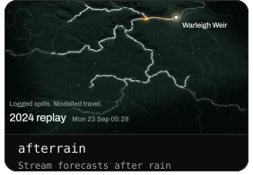

<picture><source media="(prefers-color-scheme: dark)" srcset="assets/section-neuro-dark.svg"></picture>

<picture><source media="(prefers-color-scheme: dark)" srcset="assets/section-ai-dark.svg"></picture>

<a href="mailto:yznsadoun@gmail.com">yznsadoun@gmail.com</a> Event recordings: <a href="https://eventbasedvision.github.io/eTraM/">eTraM</a> (pedestrian), <a href="https://miccunifi.github.io/FRED/">FRED</a> (drone), <a href="https://dsec.ifi.uzh.ch/">DSEC</a> (Zurich at night, CC BY-SA 4.0)

